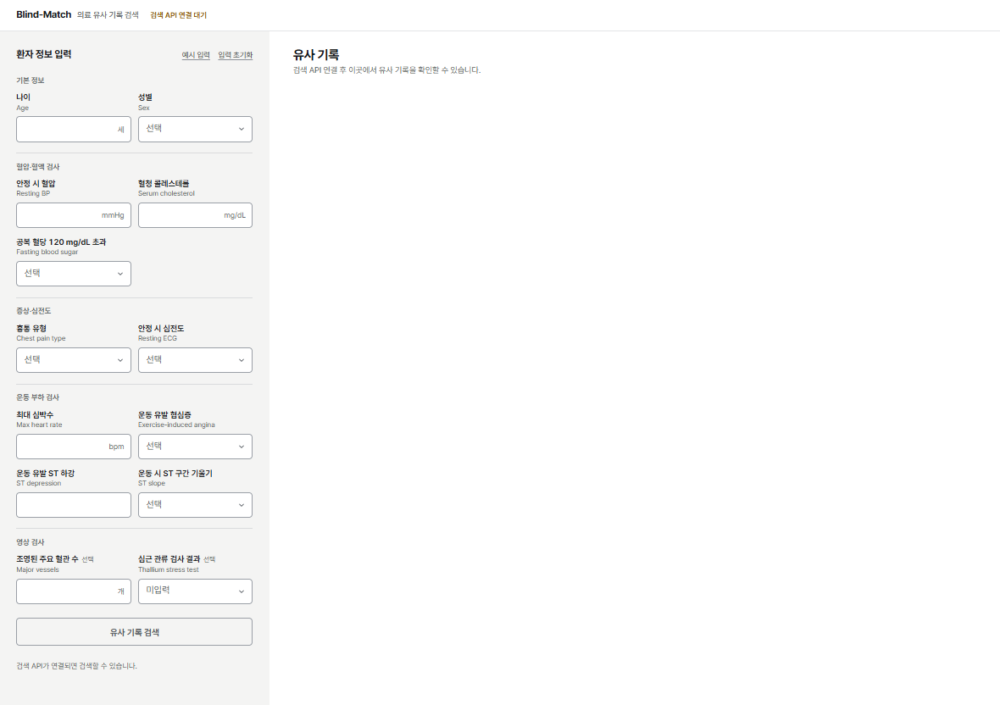
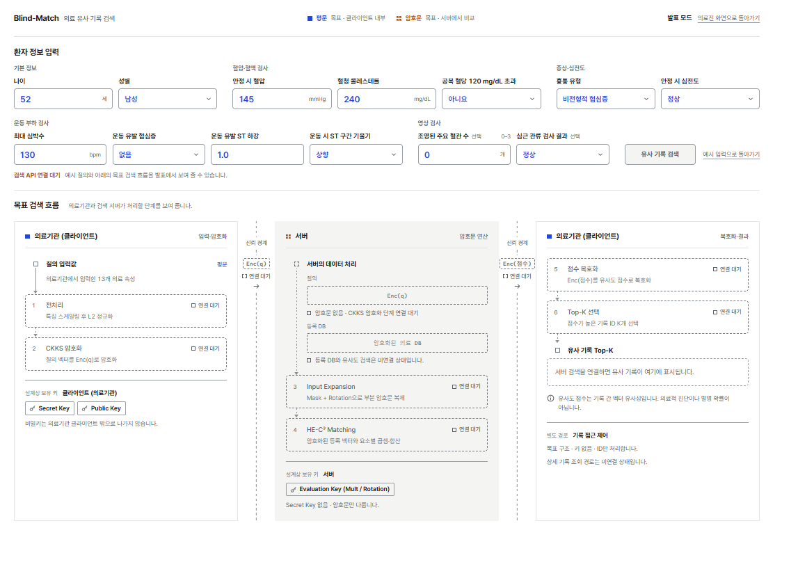
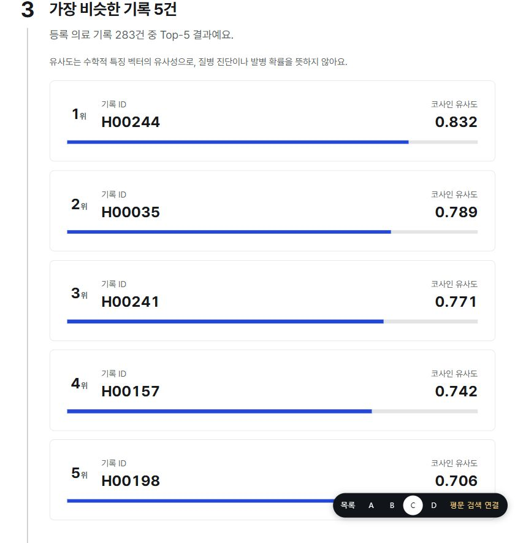
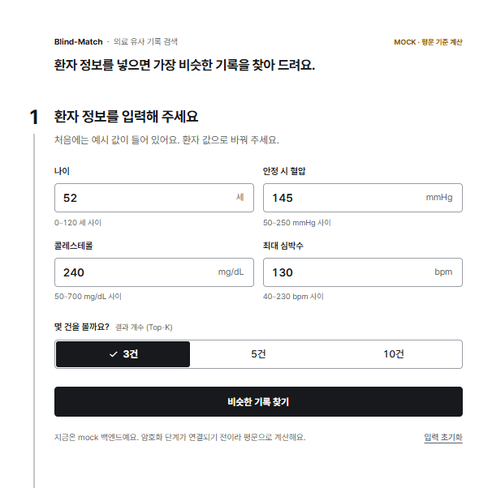
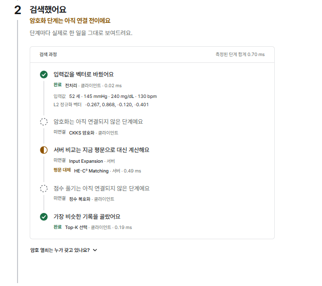
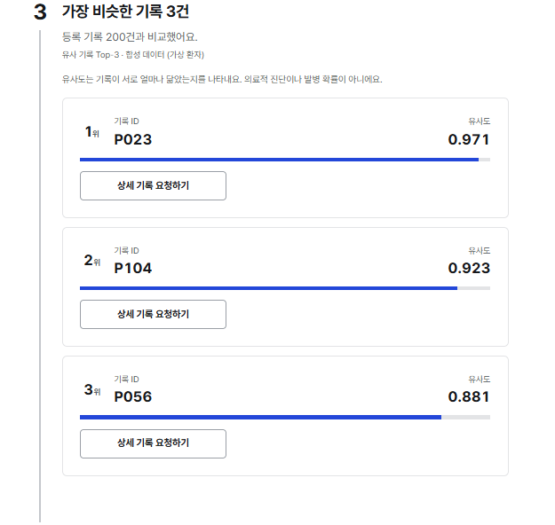
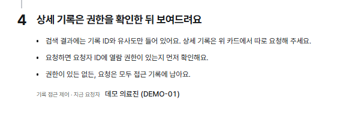
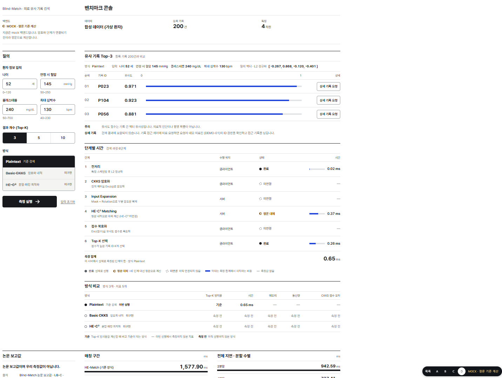

# VEIL Interface

VEIL의 의료 기록 검색 인터페이스입니다. A 의료진 검색과 C 단계형 가이드는 Cleveland 의료 속성 13개로 유사 기록을 찾습니다. 현재 검색은 공개 연구 데이터에 대한 평문 코사인 유사도 검색입니다.

## 화면과 테스트 경로

로컬 서버를 실행한 뒤 다음 화면을 열 수 있습니다.

| 화면 | 테스트할 기능 |
| --- | --- |
| [A · 의료진 검색](http://127.0.0.1:8123/) | 13개 입력과 Top-K 결과를 한 화면에서 확인 |
| [B · 발표 모드](http://127.0.0.1:8123/drafts/b) | 의료기관 → 서버 → 의료기관의 목표 암호화 검색 흐름 확인 |
| [C · 단계형 가이드](http://127.0.0.1:8123/drafts/c) | API 설정 시 입력, 검색 과정, 유사 기록을 단계별로 확인 |
| [C · 합성 데이터 데모](http://127.0.0.1:8123/drafts/c?state=legacy) | 합성 데이터 Top-3 검색과 상세 기록 열람 허용·거부 시연 |
| [D · 벤치마크 콘솔](http://127.0.0.1:8123/drafts/d) | 합성 데이터 검색과 단계별 실행 시간 확인 |

화면 하단의 **목록**에서 [전체 시안](http://127.0.0.1:8123/drafts)을 열 수 있습니다.

## 화면 미리보기

### A · 의료진 검색

환자 속성 13개를 다섯 그룹으로 입력합니다. 아래는 검색 API 연결 전 화면입니다.



### B · 발표 모드

의료기관의 질의 입력부터 서버 연산과 의료기관의 결과 확인까지 목표 흐름을 보여줍니다.



### C · API 검색

**예시 값 채우기 → 실제 의료 기록 검색**으로 Top-5를 확인할 수 있습니다. 검색 후 입력값이나 결과 개수를 바꾸면 **이전 검색 결과**가 표시됩니다. 검색 결과에는 기록 ID와 코사인 유사도가 표시되며, 상세 기록 조회는 별도 연동이 필요합니다.



<details>
<summary>C · 단계형 가이드 (합성 데이터 데모)</summary>

| 환자 정보 입력 | 검색 과정 |
| --- | --- |
|  |  |

| 유사 기록 Top-3 | 상세 기록 열람 안내 |
| --- | --- |
|  |  |

</details>

<details>
<summary>D · 벤치마크 콘솔 (합성 데이터 데모)</summary>

평문 검색 결과와 단계별 실행 시간을 표시합니다. 하단의 논문 보고값은 별도로 표시됩니다.



</details>

## 저장소별 역할

| 저장소 | 역할 |
| --- | --- |
| [Interface-](https://github.com/VEIL010/Interface-) | 의료 속성 입력과 검색 결과 표시 |
| [Medical-Data-Pipeline](https://github.com/VEIL010/Medical-Data-Pipeline) | 의료 데이터 전처리와 벡터화 |
| [Medical-Search-API](https://github.com/VEIL010/Medical-Search-API) | 검색 요청 처리와 검색 엔진 연동 |
| [BlindMatchCore](https://github.com/VEIL010/BlindMatchCore) | CKKS 암호화와 HE-C³ 연산 |

의료기관 측 인터페이스가 13개 속성을 질의 벡터로 변환합니다. 검색 API는 평문 벡터를 등록 벡터와 비교하고 순위, 기록 ID, 유사도 점수를 반환합니다. B의 CKKS·HE-C³ 흐름은 설계 시연입니다.

## 검색 API 연결

검색 API 연결은 선택 사항입니다. 연결 설정이 비어 있으면 A는 연결 대기 상태로, C는 합성 데이터 데모로 열립니다.

1. [Medical-Data-Pipeline 실행 방법](https://github.com/VEIL010/Medical-Data-Pipeline#2-실행-방법)을 따라 의존성을 설치하고 `python preprocess.py --pad-to 32 --query-count 20`을 실행합니다.
2. [Medical-Search-API 실행 방법](https://github.com/VEIL010/Medical-Search-API#실행)을 따라 별도 터미널에서 API를 포트 `8200`으로 실행합니다. `VEIL_DATA_DIR`은 1단계 산출물 폴더로 지정합니다.
3. `Interface-` 루트에서 아래 환경 변수를 설정한 뒤, 같은 PowerShell에서 [로컬 실행](#로컬-실행) 명령을 실행합니다. 예시는 저장소들이 같은 상위 폴더에 있을 때의 경로입니다.

```powershell
$env:VEIL_SEARCH_API_URL = "http://127.0.0.1:8200"
$env:VEIL_PIPELINE_DIR = (Resolve-Path "..\Medical-Data-Pipeline\data\processed\heart").Path
```

| 환경 변수 | 설명 |
| --- | --- |
| `VEIL_SEARCH_API_URL` | Medical-Search-API 주소. 없으면 검색을 켜지 않습니다 |
| `VEIL_SEARCH_API_KEY` | 검색 서버에 `VEIL_API_KEY`를 설정한 경우 같은 값을 사용합니다 |
| `VEIL_PIPELINE_DIR` | `preprocessor.joblib`과 `metadata.json`이 있는 폴더. 기본값은 `webui/.pipeline-data`입니다 |

전처리기를 만들 때는 `webui/requirements.txt`와 같은 scikit-learn 버전을 사용하고, 팀에서 생성한 `preprocessor.joblib`을 사용합니다.

## 로컬 실행

Python 3.12를 기준으로 확인했습니다. 저장소 루트에서 실행합니다.

```powershell
python -m venv .venv
.\.venv\Scripts\python.exe -m pip install -r webui/requirements.txt
.\.venv\Scripts\python.exe -m uvicorn app.main:app --app-dir webui --host 127.0.0.1 --port 8123
```

브라우저에서 [의료진 검색 화면](http://127.0.0.1:8123/)을 엽니다. macOS와 Linux에서는 `.venv/bin/python`을 사용합니다.

## 스모크 테스트

스모크 테스트는 임시 전처리기와 모의 검색 API를 사용합니다. 별도 검색 서버 없이 C 합성 데모와 A·C의 검색 연동 경로를 검증할 수 있습니다.

```powershell
.\.venv\Scripts\python.exe -m pip install -r webui/requirements-dev.txt
.\.venv\Scripts\python.exe webui/tests/smoke.py
```
