# VEIL Interface

VEIL의 의료 기록 검색 인터페이스입니다. A·B·C·D 네 시안 모두 검색 API가 연결되면 Cleveland 의료 속성 13개로 유사 기록을 찾습니다. 현재 검색은 공개 연구 데이터에 대한 평문 코사인 유사도 검색입니다.

## 화면과 테스트 경로

로컬 서버를 실행한 뒤 다음 화면을 열 수 있습니다.

| 화면 | 테스트할 기능 |
| --- | --- |
| [B · 발표 모드](http://127.0.0.1:8123/drafts/b) | 의료기관 → 서버 → 의료기관 세 레인에 목표 암호화 흐름을 보여 주고, API 설정 시 실제 검색의 단계 상태(완료·평문 대체·미연결)와 측정 시간, 질의 벡터 q를 표시 |
| [B · 합성 데이터 데모](http://127.0.0.1:8123/drafts/b?state=legacy) | 합성 데이터 검색과 상세 기록 열람 허용·거부 시연 |
| [C · 단계형 가이드](http://127.0.0.1:8123/drafts/c) | API 설정 시 입력, 검색 과정, 유사 기록을 단계별로 확인 |
| [C · 합성 데이터 데모](http://127.0.0.1:8123/drafts/c?state=legacy) | 합성 데이터 Top-3 검색과 상세 기록 열람 허용·거부 시연 |
| [D · 벤치마크 콘솔](http://127.0.0.1:8123/drafts/d) | API 설정 시 실제 검색의 단계별 시간(전처리·검색 API 계산·요청 왕복)과 통신량을 측정. 설정이 없으면 합성 데이터 데모 |
| [D · 합성 데이터 데모](http://127.0.0.1:8123/drafts/d?state=legacy) | 합성 데이터 검색과 단계별 실행 시간 확인 |
| [DB · 데이터셋 등록](http://127.0.0.1:8124/register) | 별도 로컬 프로토타입에서 CSV 전체 행 검증·인코딩·평문 등록 |
| [DB · 등록본 검색](http://127.0.0.1:8124/) | 일괄 등록한 데이터셋에서 유사 기록 Top-K 검색 |
| [A · 의료진 검색](http://127.0.0.1:8123/) | 13개 입력과 Top-K 결과를 한 화면에서 확인 |

화면 하단의 **목록**에서 [전체 시안](http://127.0.0.1:8123/drafts)을 열 수 있습니다.

DB 등록·등록본 검색은 별도 `VEIL-Bulk-Local` 폴더의 `start.ps1`로 실행합니다. 이 저장소의 기본 실행 명령에는 포함되지 않습니다.

## 화면 미리보기

### B · 발표 모드

검색 API를 연결하면 **평문 검색 실행**으로 실제 검색을 하고, 의료기관 → 서버 → 의료기관 세 레인에 질의 입력값과 질의 벡터 q, 단계 상태와 측정 시간, 유사 기록 Top-K를 표시합니다. 브라우저 창 폭이 약 1,270px 이상이면 세 레인이 나란히 놓이고, 좁은 창에서는 위아래로 쌓입니다.

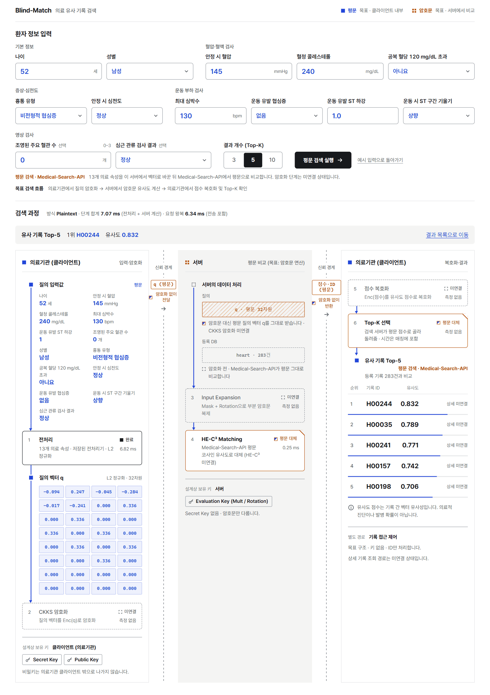

<details>
<summary>B · 검색 API 연결 전 (목표 검색 흐름)</summary>

검색 API 설정이 없으면 예시 질의와 목표 검색 흐름을 보여 주고, 각 단계를 연결 대기로 표시합니다.

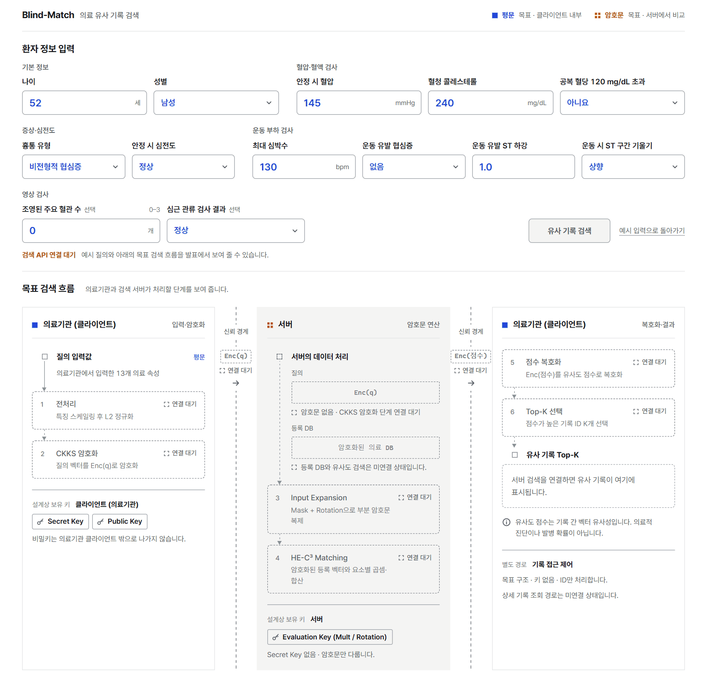

</details>

### C · API 검색

**예시 값 채우기 → 실제 의료 기록 검색**으로 Top-5를 확인할 수 있습니다. 검색 후 입력값이나 결과 개수를 바꾸면 **이전 검색 결과**가 표시됩니다. 검색 결과에는 기록 ID와 코사인 유사도가 표시되며, 상세 기록 조회는 별도 연동이 필요합니다.

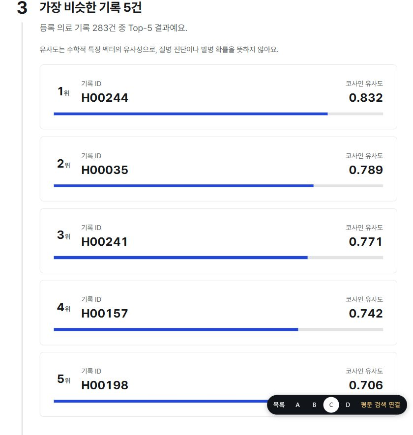

<details>
<summary>C · 단계형 가이드 (합성 데이터 데모)</summary>

| 환자 정보 입력 | 검색 과정 |
| --- | --- |
| 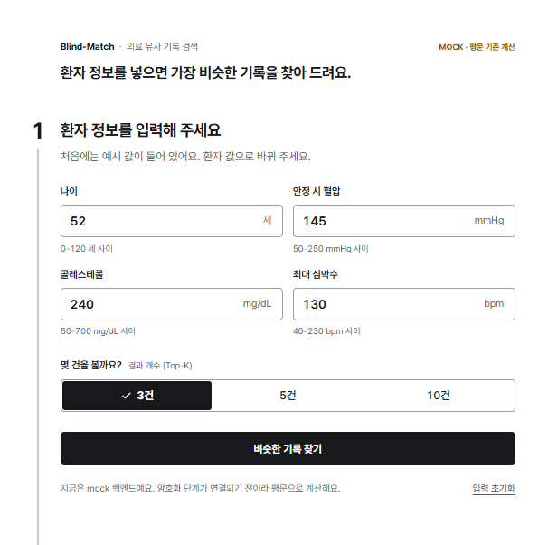 | 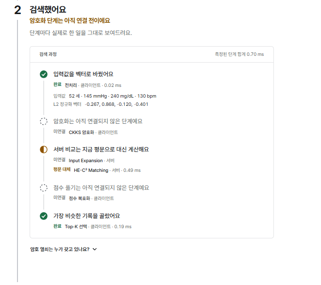 |

| 유사 기록 Top-3 | 상세 기록 열람 안내 |
| --- | --- |
| 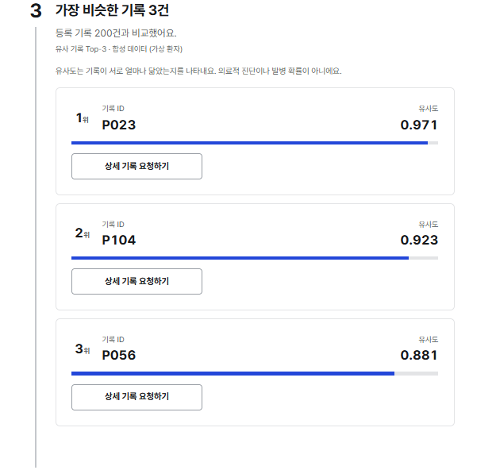 | 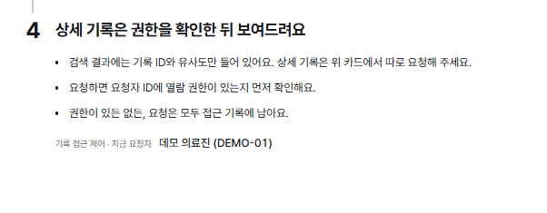 |

</details>

### D · 벤치마크 콘솔

검색 API를 연결하면 **측정 실행**으로 실제 검색의 단계별 시간(전처리·검색 API 계산·요청 왕복)과 통신량을 측정합니다. 머리에는 검색 API에 등록된 DB의 이름, 기록 수, 차원이 표시됩니다. 스크린샷은 방식 비교까지이며, 화면 맨 아래의 논문 보고값은 우리 측정값과 구분해 표시됩니다.

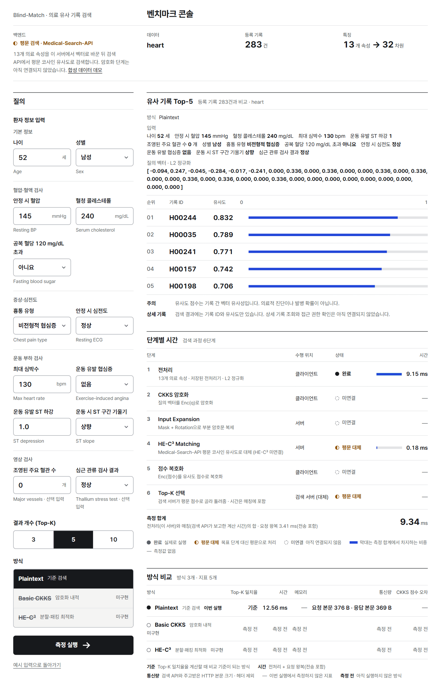

<details>
<summary>D · 벤치마크 콘솔 (합성 데이터 데모)</summary>

합성 데이터 평문 검색 결과와 단계별 실행 시간을 표시합니다.

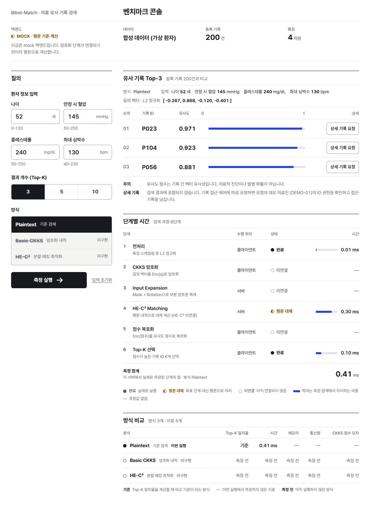

</details>

### DB · 데이터 일괄 등록 (로컬 프로토타입)

**CSV 선택 → 의료 속성 13개 열 연결 → 전체 행 검증 → 일괄 인코딩·등록** 순서로 데이터를 넣습니다. DB의 데이터를 CSV로 내보내서 사용할 수 있으며, DB 직접 접속이나 SQL 스키마 파일 등록은 아직 지원하지 않습니다. UTF-8 CSV 최대 1 MiB·2,000행을 처리합니다.

아래는 합성 데이터 24행을 32차원으로 인코딩하고 로컬 수신 서버에 등록한 화면입니다. 완료 후 첫 등록 행으로 자동 검색해 기록 ID와 유사도를 확인하고, **검색 화면에서 찾아보기**로 등록본 검색 화면에 이동합니다.

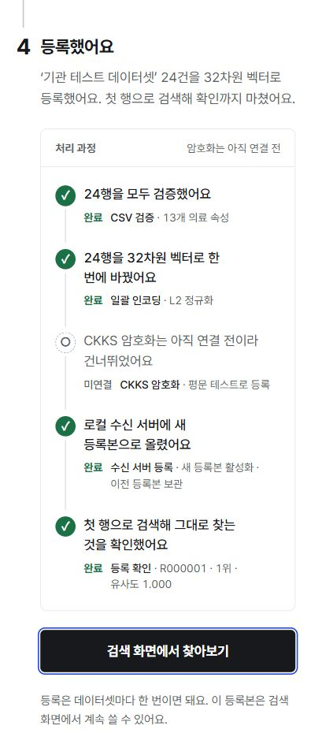

<details>
<summary>CSV 파일 선택과 검증 결과 보기</summary>

CSV 파일을 선택하거나 **합성 예시 불러오기**를 누릅니다. 열 이름이 의료 속성 키와 같으면 자동으로 연결하며, 다른 이름은 직접 연결할 수 있습니다.

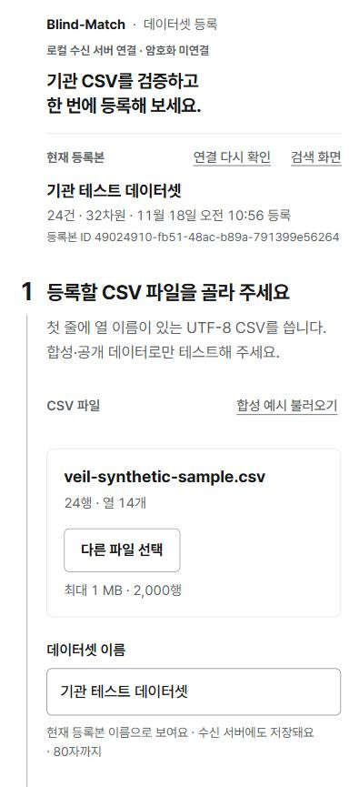

**전체 행 검증**을 누르면 처음 5행, 결측 개수, 제외할 열을 보여 줍니다. 예시의 정답 열 `target`은 검색 특징에서 제외됩니다.

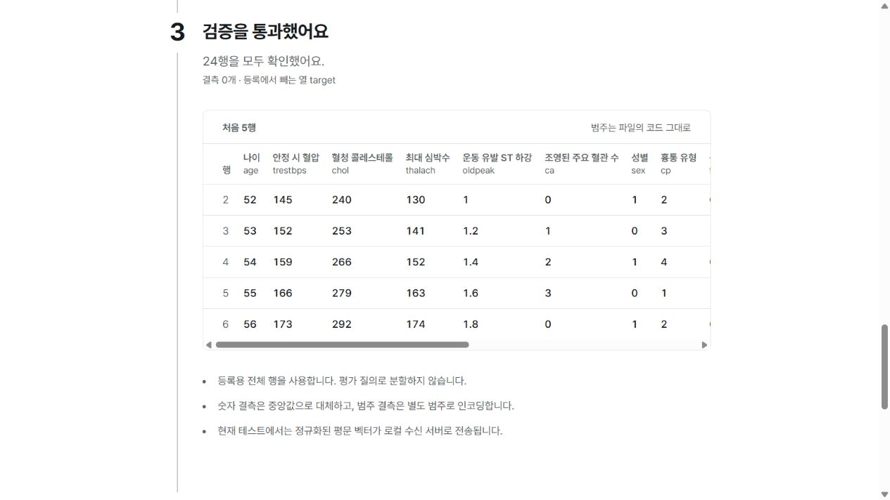

</details>

이 기능은 **별도 로컬 프로토타입**이며 구현 코드는 아직 `Interface-`에 포함되어 있지 않습니다. 현재 **CKKS 암호화는 미연결**이고, 정규화된 **평문 벡터**와 기록 ID·등록본 정보를 로컬 수신 서버에 보냅니다. 새 등록은 이 테스트 서버의 활성 등록본만 교체하며, 기존 A·B·C·D의 검색 DB는 바꾸지 않습니다.

### A · 의료진 검색

환자 속성 13개를 다섯 그룹으로 입력합니다. 아래는 검색 API 연결 전 화면입니다.

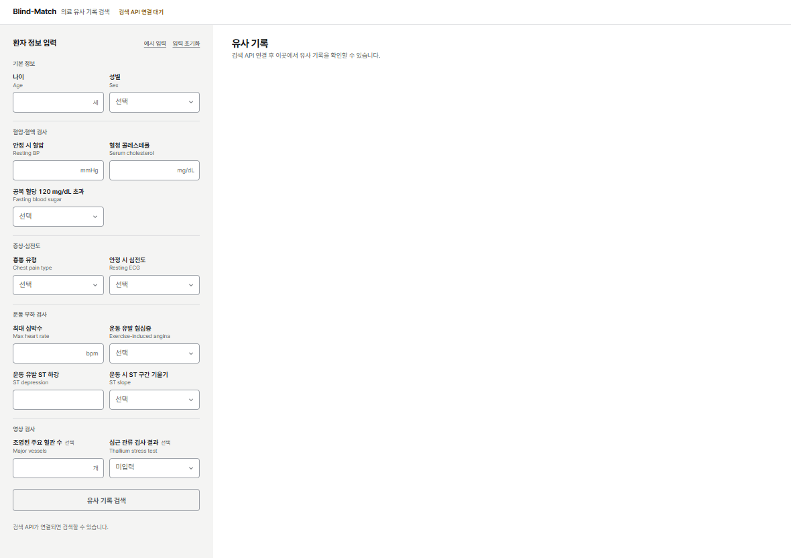

## 저장소별 역할

| 저장소 | 역할 |
| --- | --- |
| [Interface-](https://github.com/VEIL010/Interface-) | 의료 속성 입력과 검색 결과 표시 |
| [Medical-Data-Pipeline](https://github.com/VEIL010/Medical-Data-Pipeline) | 의료 데이터 전처리와 벡터화 |
| [Medical-Search-API](https://github.com/VEIL010/Medical-Search-API) | 검색 요청 처리와 검색 엔진 연동 |
| [BlindMatchCore](https://github.com/VEIL010/BlindMatchCore) | CKKS 암호화와 HE-C³ 연산 |

의료기관 측 인터페이스가 13개 속성을 질의 벡터로 변환합니다. 검색 API는 평문 벡터를 등록 벡터와 비교하고 순위, 기록 ID, 유사도 점수를 반환합니다. B의 CKKS·HE-C³ 흐름은 설계 시연이며, 실제 검색에서는 해당 단계를 미연결 또는 평문 대체로 표시합니다.

B·D가 보여 주는 측정값은 다음과 같습니다.

- **전처리**: 이 서버에서 질의 한 건을 벡터로 바꾸는 데 걸린 시간입니다. 처음 한 번 걸리는 전처리기 적재와 첫 변환 준비는 뺍니다.
- **매칭**: 검색 API가 응답에 보고한 계산 시간(`elapsed_ms`)입니다. 보고하지 않으면 요청 왕복 시간으로 대신하고, 그 단계에 "서버 계산 시간 미보고 → 요청 왕복(전송 포함)"이라고 적습니다.
- **단계 합계**: 전처리와 매칭을 더한 값입니다. B는 위쪽에 "단계 합계"로, D는 단계별 시간 표 아래에 "측정 합계"로 표시합니다.
- **요청 왕복**: 검색 API 호출의 전송 포함 시간입니다(B 위쪽 · D 측정 합계 줄).
- **D 방식 비교의 시간**: 전처리 + 요청 왕복입니다.
- **D 방식 비교의 통신량**: 검색 API와 주고받은 HTTP 본문 크기이며 헤더는 빼고 셉니다.

실제 검색에서 B는 평문 질의 벡터 q와 평문 점수·ID가 신뢰 경계를 넘는 것을 "암호화 없이 전달 · 반환"으로 표시합니다. Top-K는 목표 구조에서 의료기관이 고르지만 지금은 검색 서버가 평문 점수로 고르므로, D의 수행 위치에는 "검색 서버 (대체)"로, B의 Top-K 선택 단계에는 "평문 대체"로 표시합니다. 검색 전 화면의 등록 기록 수와 차원은 검색 API의 `/v1/meta`에서 읽고 60초 동안 기억합니다. 이 서버의 전처리기와 등록 DB의 차원이 다르면 D 머리에 경고를 띄웁니다.

## 검색 API 연결

검색 API 연결은 선택 사항입니다. 연결 설정이 비어 있으면 A·B는 연결 대기 상태로, C·D는 합성 데이터 데모로 열립니다.

1. [Medical-Data-Pipeline 실행 방법](https://github.com/VEIL010/Medical-Data-Pipeline#2-실행-방법)을 따라 의존성을 설치하고 `python preprocess.py --pad-to 32 --query-count 20`을 실행합니다.
2. [Medical-Search-API 실행 방법](https://github.com/VEIL010/Medical-Search-API#실행)을 따라 별도 터미널에서 API를 포트 `8200`으로 실행합니다. `VEIL_DATA_DIR`은 1단계 산출물 폴더로 지정합니다.
3. `Interface-` 루트에서 아래 환경 변수를 설정한 뒤, 같은 PowerShell에서 [로컬 실행](#로컬-실행) 명령을 실행합니다. 예시는 저장소들이 같은 상위 폴더에 있을 때의 경로입니다.

```powershell
$env:VEIL_SEARCH_API_URL = "http://127.0.0.1:8200"
$env:VEIL_PIPELINE_DIR = (Resolve-Path "..\Medical-Data-Pipeline\data\processed\heart").Path
```

| 환경 변수 | 설명 |
| --- | --- |
| `VEIL_SEARCH_API_URL` | Medical-Search-API 주소. 없으면 검색을 켜지 않습니다 |
| `VEIL_SEARCH_API_KEY` | 검색 서버에 `VEIL_API_KEY`를 설정한 경우 같은 값을 사용합니다 |
| `VEIL_PIPELINE_DIR` | `preprocessor.joblib`과 `metadata.json`이 있는 폴더. 기본값은 `webui/.pipeline-data`입니다 |

전처리기를 만들 때는 `webui/requirements.txt`와 같은 scikit-learn 버전을 사용하고, 팀에서 생성한 `preprocessor.joblib`을 사용합니다.

## 로컬 실행

Python 3.12를 기준으로 확인했습니다. 저장소 루트에서 실행합니다.

```powershell
python -m venv .venv
.\.venv\Scripts\python.exe -m pip install -r webui/requirements.txt
.\.venv\Scripts\python.exe -m uvicorn app.main:app --app-dir webui --host 127.0.0.1 --port 8123
```

브라우저에서 [의료진 검색 화면](http://127.0.0.1:8123/)을 엽니다. macOS와 Linux에서는 `.venv/bin/python`을 사용합니다.

## 스모크 테스트

스모크 테스트는 임시 전처리기와 모의 검색 API를 사용합니다. 별도 검색 서버 없이 합성 데이터 데모와 A·B·C·D의 검색 연동 경로를 검증할 수 있습니다.

```powershell
.\.venv\Scripts\python.exe -m pip install -r webui/requirements-dev.txt
.\.venv\Scripts\python.exe webui/tests/smoke.py
```
